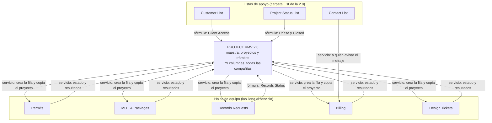
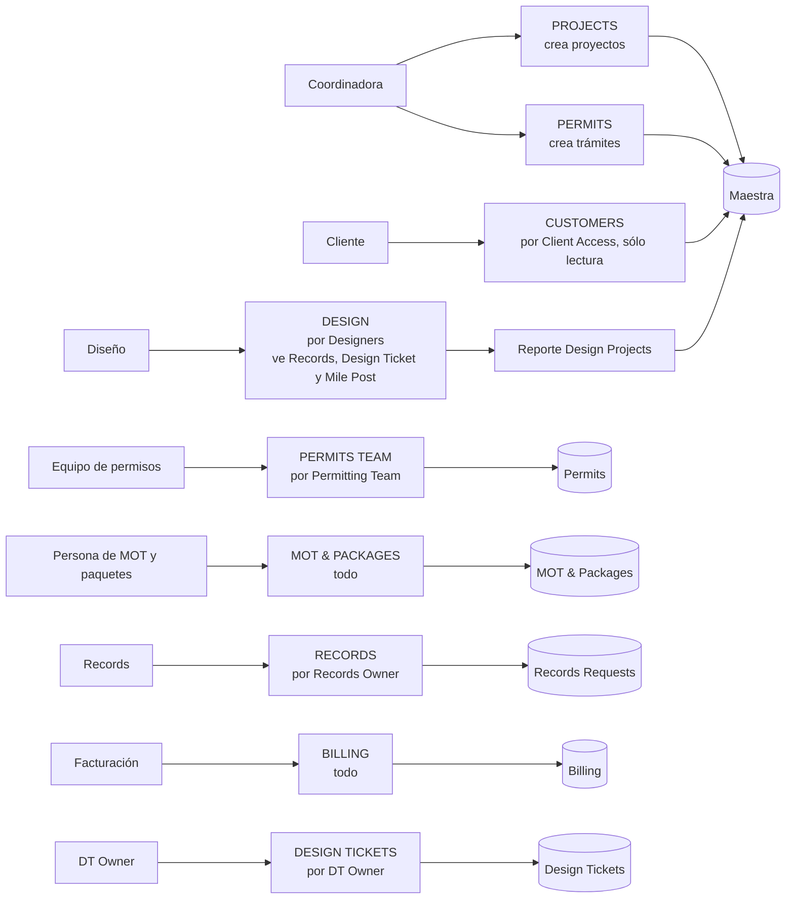
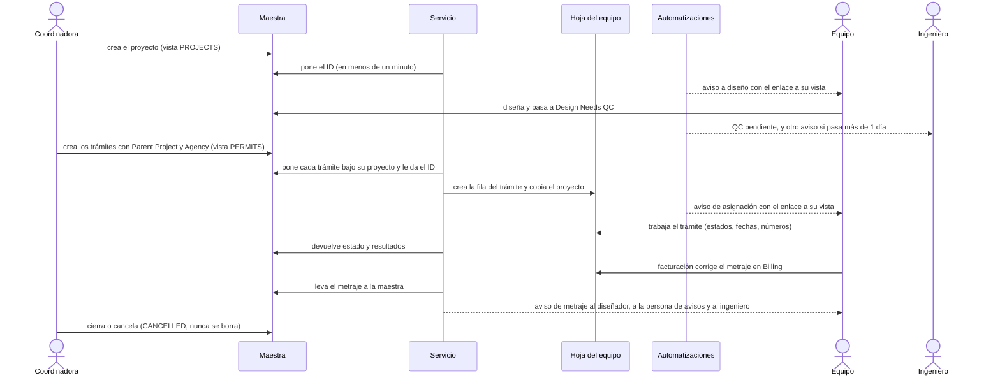
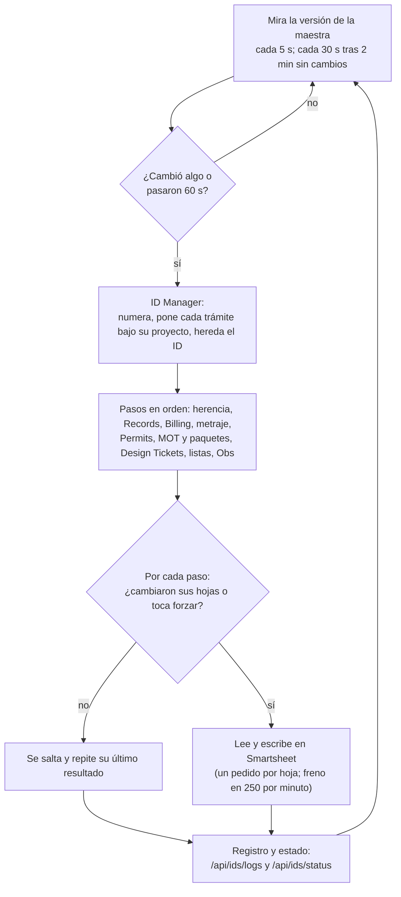
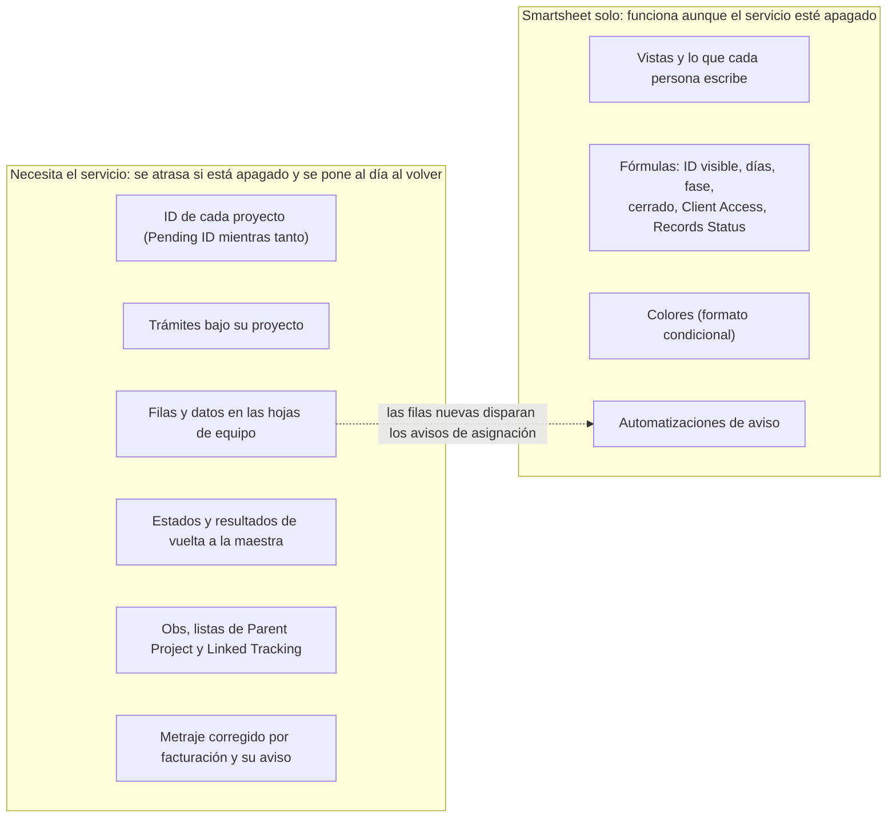

# Diagramas de la KMV 2.0 (MP-D1 a MP-D5)

Estado 2026-11-23. Los diagramas están en Mermaid: GitHub y VS Code (con la vista previa de Markdown) los dibujan solos. El texto que los explica está en `HOJAS_Y_PIEZAS.md` y `SERVICIO_Y_FLUJO.md`.

## MP-D1: hojas y quién llena qué

La maestra es la única hoja donde se crean filas. Las hojas de equipo las llena el servicio y le devuelven los resultados. Las listas de apoyo alimentan fórmulas de la maestra.

## MP-D2: vistas, quién las usa y de dónde leen

Nadie trabaja en las hojas: cada persona entra por su vista y ve sólo lo suyo.

## MP-D3: el flujo de un proyecto

Quién hace cada paso: una persona, el servicio o Smartsheet solo (automatizaciones y fórmulas).

## MP-D4: cómo corre el servicio

## MP-D5: qué depende del servicio

